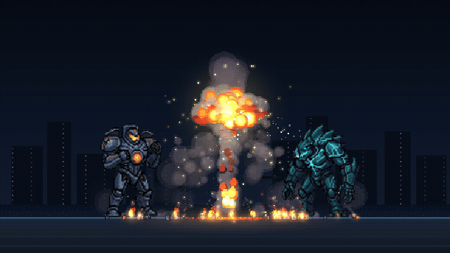
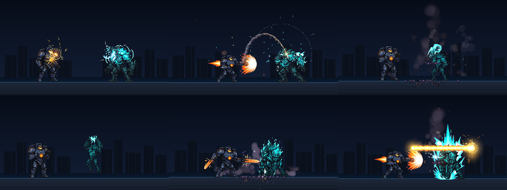
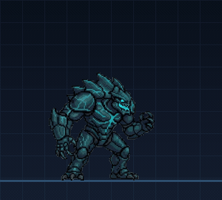
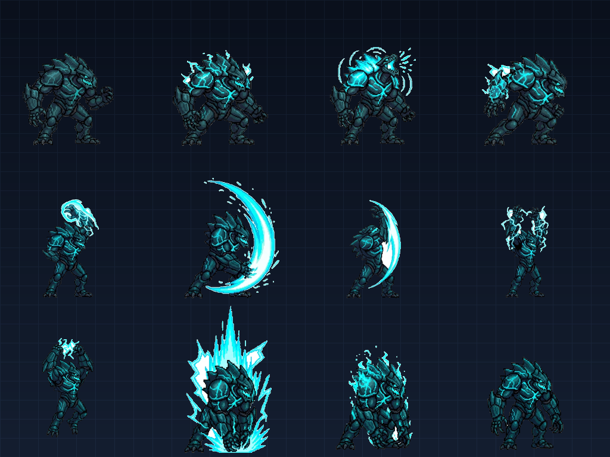
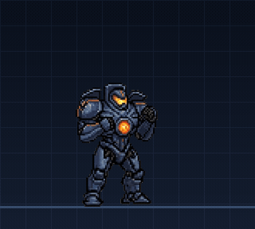
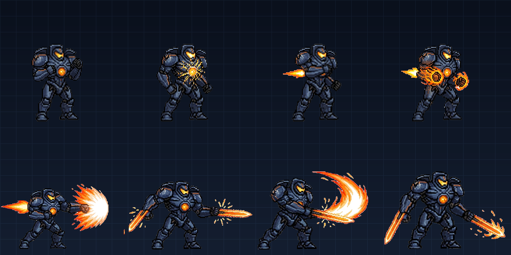
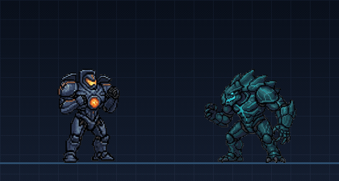

# Pacific Rim Pixel Art + `pixelfx` Boss Battle Showcase

HD hi-bit pixel art sprite sheets (**256×256 per frame**, transparent RGBA) for a **Jaeger Mech** and a **Category IV Kaiju**, choreographed into an **11.2-second (269 frames @ 24fps)** boss fight powered by procedural pixel-art VFX from [`patch-gg/pixelfx`](https://github.com/patch-gg/pixelfx).

---

## 1. Full 11.2s `pixelfx` Boss Battle (GIF Preview)



- **Full HD Video (960×540 @ 24fps MP4):** [`assets/previews/pacific_rim_pixelfx_battle.mp4`](assets/previews/pacific_rim_pixelfx_battle.mp4)
- **VFX used from `pixelfx`:** `lightning/charge-up`, `projectiles/homing-missile`, `explosions/small-explosion`, `explosions/plasma-explosion`, `explosions/big-explosion`, `impacts/ground-slam`, `lightning/thunderclap`, `melee/sword-slash`, `melee/spin-slash`, `arcane/arcane-beam`, `scifi/emp-blast` — composited with `back`/`front` layers, true additive glow, arcade hit-stop freeze frames, and camera shake.

### Storyboard (6 Key Beats)


---

## 2. Kaiju — 12-Frame HD Super-Combo (256×256/frame)

| Live Preview | 12-Frame Contact Sheet (4×3) |
| :---: | :---: |
|  |  |

- **Transparent Sprite Sheet (3072×256, 12 × 256×256):** [`assets/sprites/kaiju_hd_12frame_sheet_3072x256.png`](assets/sprites/kaiju_hd_12frame_sheet_3072x256.png)
- **64×64 Static Sprite:** [`assets/sprites/kaiju_64x64.png`](assets/sprites/kaiju_64x64.png)
- **80×80 4-Frame Claw Slash Sheet:** [`assets/sprites/kaiju_slash_sheet_320x80.png`](assets/sprites/kaiju_slash_sheet_320x80.png)

---

## 3. Jaeger Mech — 8-Frame HD Super-Combo (256×256/frame)

| Live Preview | 8-Frame Contact Sheet (4×2) |
| :---: | :---: |
|  |  |

- **Transparent Sprite Sheet (2048×256, 8 × 256×256):** [`assets/sprites/jaeger_hd_8frame_sheet_2048x256.png`](assets/sprites/jaeger_hd_8frame_sheet_2048x256.png)

---

## 4. Direct HD Duel Loop (No Extra VFX)



---

## Re-render the Battle Locally

Requires **Node.js 18+** and **ffmpeg**:

```bash
git clone --depth 1 https://github.com/patch-gg/pixelfx ./pixelfx
PIXELFX_DIR=./pixelfx node scripts/render_pacific_rim_battle.mjs
```
